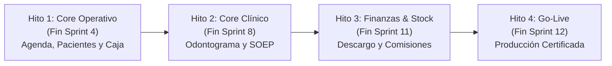

# PLAN MAESTRO DE IMPLEMENTACIÓN Y SEGUIMIENTO POR FASES
## Proyecto: Sistema Integral de Gestión Odontológica y Expediente Clínico Digital (SIGO-Dental)

**Versión:** 1.0  
**Fecha de Inicio:** Noviembre 2026  
**Duración Total Estimada:** 12 Sprints (24 Semanas de Desarrollo + 2 Semanas de Estabilización)  
**Documentos de Referencia:**
* [`SRS_SIGO_Dental.md`](./SRS_SIGO_Dental.md) (Especificación de Requerimientos de Software)
* [`ARQUITECTURA_TECNICA_SIGO_DENTAL.md`](./ARQUITECTURA_TECNICA_SIGO_DENTAL.md) (Diseño de Arquitectura y Sistema)
* [`GEMINI.md`](./GEMINI.md) (Reglas del Proyecto para el Asistente AI)
* [`docs/ESPECIFICACION_PANTALLAS_UI_UX.md`](./docs/ESPECIFICACION_PANTALLAS_UI_UX.md) (Wireframes y Pantallas UI/UX)
* [`docs/ESTANDARES_SEGURIDAD_OWASP_ASVS.md`](./docs/ESTANDARES_SEGURIDAD_OWASP_ASVS.md) (Estándares de Seguridad OWASP y ASVS Nivel 2)
* [`docs/MODELO_DATOS_RBAC_DINAMICO_Y_ERRORES.md`](./docs/MODELO_DATOS_RBAC_DINAMICO_Y_ERRORES.md) (RBAC Dinámico, Partial Indexes y Errores RFC 7807)

---

## 1. CUADRO DE CONTROL Y ESTADO GENERAL DE FASES

| Fase | Título de la Fase | Sprints | Documento de Detalle | Estado | Progreso |
| :---: | :--- | :---: | :---: | :---: | :---: |
| **Fase 1** | **Core Administrativo, Pacientes, Agenda y Facturación Básica** | Sprints 1 - 4 | [`FASE_1_CORE_ADMINISTRATIVO_Y_TURNOS.md`](./docs/fases/FASE_1_CORE_ADMINISTRATIVO_Y_TURNOS.md) | `[ ] En Espera` | 0% |
| **Fase 2** | **Core Clínico, Odontograma, Periodontograma y Expediente Digital** | Sprints 5 - 8 | [`FASE_2_CORE_CLINICO_ODONTOLOGICO.md`](./docs/fases/FASE_2_CORE_CLINICO_ODONTOLOGICO.md) | `[ ] Bloqueada` | 0% |
| **Fase 3** | **Finanzas Avanzadas, Inventarios, Comisiones y Reportes BI** | Sprints 9 - 11 | [`FASE_3_FINANZAS_INVENTARIOS_Y_ANALITICA.md`](./docs/fases/FASE_3_FINANZAS_INVENTARIOS_Y_ANALITICA.md) | `[ ] Bloqueada` | 0% |
| **Fase 4** | **Pruebas UAT, Ciberseguridad, Carga y Despliegue a Producción** | Sprint 12 | [`FASE_4_QA_SEGURIDAD_Y_GO_LIVE.md`](./docs/fases/FASE_4_QA_SEGURIDAD_Y_GO_LIVE.md) | `[ ] Bloqueada` | 0% |

---

## 2. HITOS PRINCIPALES Y COMPUERTAS DE CALIDAD (MILESTONES)

### Hito 1: Plataforma Base y Operación de Recepción
- [ ] Docker Compose inicial operativo con PostgreSQL, Redis, MinIO, ClamAV, Backend y Frontend.
- [ ] Autenticación RBAC con sesiones híbridas JWT + Redis y cierre por inactividad a los 15 minutos.
- [ ] Alta de pacientes con encriptación AES-256-GCM para datos médicos sensibles (LOPDP).
- [ ] Agenda multirrecinto con bloqueo a nivel de base de datos contra colisiones de sillones físicos.
- [ ] Punto de venta con soporte para pagos mixtos y arqueo bajo protocolo de cierre ciego.

### Hito 2: Expediente Clínico Digital Odontológico
- [ ] Odontograma vectorial 2D interactivo con soporte de nomenclaturas FDI y Universal.
- [ ] Marcado anatómico de 5 superficies por pieza dental con histórico inicial vs. evolutivo.
- [ ] Periodontograma digital automatizado con cálculo en tiempo real de NIC ($PS + MG$).
- [ ] Notas de evolución clínica bajo formato SOEP bloqueadas contra edición tras 24 horas.
- [ ] Consentimientos informados con firma biométrica en pantalla y recetas con código QR.

### Hito 3: Logística y Finanzas Clínicas Automatizadas
- [ ] Descargo atómico de insumos por sillón/consultorio al marcar procedimientos como atendidos.
- [ ] Control de insumos por número de lote y fecha de caducidad con alertas preventivas.
- [ ] Motor de liquidación de comisiones con deducción previa de costos de laboratorio externo.
- [ ] Presupuestos multinivel por fases clínicas con validez de 30 días y conversión a citas.
- [ ] Tablero de mando directivo con indicadores clínicos y financieros en tiempo real.

### Hito 4: Certificación de Seguridad y Puesta en Producción
- [ ] Pruebas de aceptación UAT aprobadas por el personal médico y administrativo.
- [ ] Escaneo de malware en streaming con ClamAV verificado en el almacenamiento de archivos.
- [ ] Auditoría de seguridad SAST/DAST sin vulnerabilidades críticas o altas.
- [ ] Pruebas de carga con K6 soportando 300 usuarios concurrentes con latencia $< 1.5\text{ s}$.
- [ ] Pase formal a producción y entrega de especificación OpenAPI 3.0 / Swagger.

---

## 3. PROTOCOLO DE ACTUALIZACIÓN DEL PROGRESO
Cada vez que el equipo de desarrollo complete una tarea o sprint:
1. Se marcará el checkbox correspondiente `[x]` en el archivo de la fase respectiva (`docs/fases/FASE_X_...md`).
2. Se actualizará el porcentaje de avance en este archivo maestro [`PLAN_DE_IMPLEMENTACION.md`](./PLAN_DE_IMPLEMENTACION.md).
3. Todo cambio en la arquitectura o reglas de negocio deberá reflejarse en [`ARQUITECTURA_TECNICA_SIGO_DENTAL.md`](./ARQUITECTURA_TECNICA_SIGO_DENTAL.md) y [`GEMINI.md`](./GEMINI.md).

