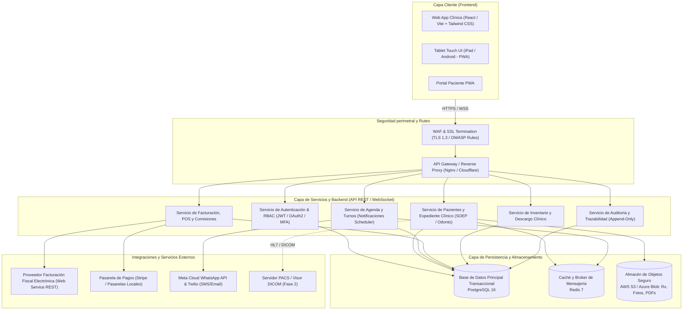
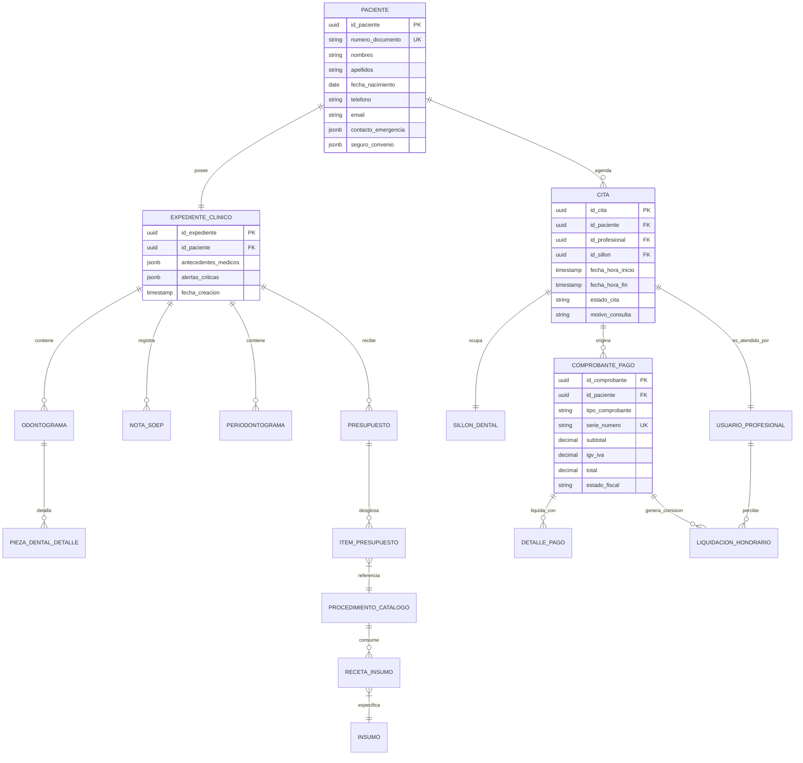
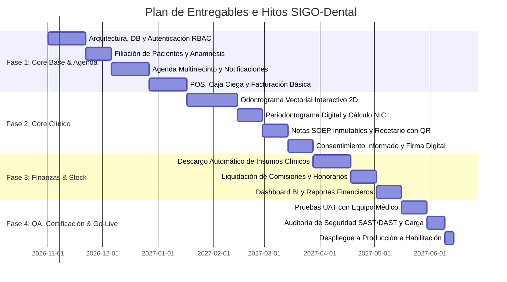

# DOCUMENTO DE ESPECIFICACIÓN DE REQUERIMIENTOS DE SOFTWARE (SRS / BRD)

**Proyecto:** Sistema Integral de Gestión Odontológica y Expediente Clínico Digital (**SIGO-Dental**)  
**Destinatario:** Departamento de Tecnología de la Información (TI) / Equipo de Arquitectura y Desarrollo  
**Versión:** 1.0  
**Fecha:** 29 de octubre de 2026  
**Estado:** Para Revisión Técnica y Estimación  
**Clasificación:** Confidencial / Propiedad Interna  

---

## 1. CONTROL DE VERSIONES Y AUTORIZACIONES

### 1.1 Historial de Cambios

| Versión | Fecha | Autor / Rol | Descripción del Cambio |
| :--- | :--- | :--- | :--- |
| **0.1** | 15/10/2026 | Analista Funcional | Borrador inicial de requerimientos clínicos y de agenda. |
| **0.5** | 22/10/2026 | Arquitecto de Soluciones | Integración de requerimientos no funcionales, seguridad y arquitectura. |
| **1.0** | 29/10/2026 | Líder Funcional / Clínica Odontológica | Levantamiento, consolidación final de requerimientos funcionales, técnicos, reglas de negocio y criterios de aceptación. |

### 1.2 Firmas de Aprobación

| Rol | Nombre | Firma / Estado | Fecha |
| :--- | :--- | :--- | :--- |
| **Sponsor del Negocio** (Director Médico) | Dr. Roberto Méndez | Pendiente de Revisión | 29/10/2026 |
| **Product Owner / Analista Funcional** | Lic. Mariana Silva | Aprobado | 29/10/2026 |
| **Arquitecto de Soluciones / TI Lead** | Ing. Carlos Valenzuela | Aprobado | 29/10/2026 |
| **Oficial de Seguridad de la Información (CISO)** | Ing. Valeria Torres | Pendiente de Revisión | 29/10/2026 |

---

## 2. INTRODUCCIÓN Y ALCANCE

### 2.1 Propósito
El presente documento define formalmente los requerimientos funcionales, requerimientos no funcionales, reglas de negocio, modelos conceptuales e interfaces de integración necesarios para el diseño, desarrollo, pruebas, certificación y despliegue del software clínico-administrativo **SIGO-Dental**. Está dirigido a desarrolladores, arquitectos de software, especialistas de QA, directores médicos y administradores de clínicas odontológicas.

### 2.2 Objetivos del Negocio
* **Digitalización Total:** Digitalizar el 100% de los expedientes clínicos, periodontogramas, odontogramas y recetas odontológicas, eliminando el soporte en papel.
* **Reducción de Inasistencias:** Reducir la tasa de ausentismo (No-Show) de pacientes en al menos un 35% mediante recordatorios y confirmaciones automáticas multicanal (WhatsApp Business API, SMS y correo electrónico).
* **Control Operativo y Financiero:** Centralizar el control de inventario de insumos clínicos por consultorio/sillón dental y profesional, automatizando el descargo por procedimiento y liquidando honorarios/comisiones con precisión.
* **Cumplimiento Normativo Estricto:** Garantizar el cumplimiento de normativas de protección de datos personales de salud (Ley de Protección de Datos Personales, estándares equivalentes a HIPAA/GDPR y regulaciones sanitarias del Ministerio de Salud aplicable).
* **Eficiencia Clínica:** Disminuir en un 40% el tiempo promedio de registro de evolución médica mediante interfaces ergonómicas y estructuradas (formato SOEP).

### 2.3 Glosario y Acrónimos

| Término | Definición |
| :--- | :--- |
| **SOEP** | Método de registro clínico estandarizado: **S**ubjetivo, **O**bjetivo, **E**valuación y **P**lan. |
| **Odontograma** | Esquema gráfico anatómico/geométrico de las piezas dentales que representa el estado patológico y tratamientos realizados o proyectados. |
| **Periodontograma** | Ficha gráfica para registrar profundidad de sondaje, nivel de inserción, sangrado y supuración de los tejidos periodontales. |
| **FDI** | Nomenclatura dental de la Federación Dental Internacional (dos dígitos: cuadrante y diente). |
| **Universal** | Sistema de numeración dental americano (1 al 32 para permanentes; A a T para temporales). |
| **NIC** | Nivel de Inserción Clínica periodontal (distancia de la unión cemento-esmalte al fondo del surco gingival). |
| **OTP** | *One-Time Password* (contraseña de un solo uso para validación de identidad o firmas). |
| **PACS / DICOM** | *Picture Archiving and Communication System* / *Digital Imaging and Communication in Medicine* (estándar para imágenes radiológicas). |
| **RBAC** | *Role-Based Access Control* (Control de acceso basado en roles). |

### 2.4 Alcance del Sistema

#### Dentro del Alcance (Fase 1 - Core MVP y Operación Clínica)
* Portal Web Responsive y PWA para personal clínico (odontólogos, asistentes) y administrativo (recepción, caja, gerencia).
* Módulo integral de pacientes (filiación, antecedentes sistémicos, alergias y alertas visuales).
* Odontograma interactivo bidimensional (2D) vectorial con soporte FDI y Universal para dentición permanente y temporal.
* Periodontograma digital completo con cálculo automático de NIC.
* Notas de evolución clínica bajo metodología SOEP con firma digital y bloqueo temporal inmutable.
* Consentimientos informados dinámicos con firma digital/biométrica en pantalla o validación OTP.
* Agenda multi-sucursal, multi-profesional y multi-sillón con prevención de sobreposiciones físicas.
* Notificaciones y recordatorios automáticos transaccionales vía WhatsApp, SMS y Email.
* Planes de tratamiento por fases/sesiones y presupuestos multinivel con conversión a citas.
* Módulo de Facturación Electrónica y Punto de Venta (POS) con soporte para pagos mixtos y arqueo ciego.
* Gestión de inventario clínico con descargo automático por procedimiento odontológico.
* Liquidación de honorarios a odontólogos según reglas variables (porcentaje, montos fijos, deducción de laboratorios).
* Módulo de auditoría forense inmutable y trazabilidad de accesos.

#### Fuera del Alcance (Fase 1)
* Aplicación móvil nativa en tiendas (iOS App Store / Google Play Store) para pacientes (en Fase 1 se cubrirá mediante Portal PWA web).
* Procesamiento y reconstrucción volumétrica 3D de tomografías computarizadas *Cone Beam* (CBCT) dentro del navegador (se manejará almacenamiento de archivos planos y enlace a visualizadores PACS externos).
* Facturación de múltiples razones sociales bajo una misma sucursal en esquemas de consorcio holding no estándar.

---

## 3. PERFILES DE USUARIO Y MATRIZ RACI / ROLES

### 3.1 Perfiles de Usuario

| Rol | Descripción | Permisos Clave |
| :--- | :--- | :--- |
| **Administrador TI / Sistema** | Responsable de la infraestructura, seguridad, auditoría y parametrización general. | Gestión de usuarios, asignación de roles, auditoría de logs, configuración de integraciones (APIs), backups y catálogos maestros. |
| **Director Médico / Administrador Clínico** | Supervisión clínica, aprobación de protocolos, fijación de aranceles y reportería general. | Acceso completo a métricas operativas, reportes de productividad médica, anulación excepcional de transacciones y auditoría clínica. |
| **Recepcionista / Cajero** | Gestión de atención presencial/telefónica, agendamiento de turnos y cobranza. | Registro de pacientes, asignación y reprogramación de citas, emisión de boletas/facturas, recepción de pagos y cierre de caja diario. |
| **Odontólogo General / Especialista** | Profesionales de la salud dental encargados del diagnóstico y tratamiento directo. | Acceso y edición de historias clínicas, marcado de odontograma y periodontograma, formulación de diagnósticos, planes de tratamiento, recetas y notas SOEP. |
| **Asistente Dental** | Personal de apoyo en gabinete/sillón clínico. | Registro de signos vitales, preparación de fichas, toma de notas asistidas, consulta de insumos y apoyo en marcaje de sondaje periodontal. |
| **Auditor / Contador** | Personal contable y de finanzas corporativas. | Supervisión de arqueos de caja, liquidación de comisiones a profesionales, reportes fiscales, conciliación bancaria e inventarios valorizados. |
| **Paciente (Portal PWA)** | Usuario final receptor de los servicios de salud. | Consulta de citas programadas, historial de presupuestos aprobados, recetas emitidas y firma de consentimientos informados pendientes. |

### 3.2 Matriz RACI por Módulo Operativo

* **R (Responsible):** Quien ejecuta la tarea.
* **A (Accountable):** Quien aprueba y responde en última instancia.
* **C (Consulted):** Quien es consultado para aportar información técnica/clínica.
* **I (Informed):** Quien es notificado tras la ejecución.

| Actividad / Proceso | Admin TI | Director Médico | Recepción / Caja | Odontólogo | Asistente | Contador / Auditor | Paciente |
| :--- | :---: | :---: | :---: | :---: | :---: | :---: | :---: |
| **Alta y Filiación de Paciente** | I | I | **R / A** | C | I | I | C |
| **Registro de Anamnesis y Alertas Médicas** | I | C | I | **A** | **R** | I | C |
| **Diagnóstico y Odontograma / Periodontograma** | I | C | I | **R / A** | C | I | I |
| **Elaboración y Firma de Notas SOEP** | I | C | I | **R / A** | C | I | I |
| **Emisión y Firma de Consentimiento Informado** | I | C | C | **A** | C | I | **R** |
| **Creación de Presupuesto Odontológico** | I | C | C | **R / A** | I | I | C |
| **Aprobación de Presupuesto** | I | I | C | C | I | I | **R / A** |
| **Agendamiento y Gestión de Citas** | I | I | **R / A** | C | I | I | C |
| **Emisión de Comprobante de Pago (POS/Factura)** | I | I | **R** | I | I | **A** | I |
| **Arqueo y Cierre Ciego de Caja** | I | C | **R** | I | I | **A** | I |
| **Descargo de Inventario por Procedimiento** | I | I | I | C | **R / A** | C | I |
| **Liquidación de Honorarios Médicos** | I | C | I | I | I | **R / A** | I |
| **Auditoría de Seguridad y Trazabilidad de Accesos** | **R / A** | C | I | I | I | C | I |

---

## 4. REQUERIMIENTOS FUNCIONALES (RF)

### 4.1 Módulo: Gestión de Pacientes y Filiación

* **RF-01 (Registro Unificado de Paciente):**
  * El sistema debe permitir el alta, búsqueda avanzada (por documento de identidad, nombre, teléfono o correo), consulta y edición de la ficha maestra del paciente.
  * Debe registrar: documento de identidad único, nombres, apellidos, fecha de nacimiento, sexo biológico, dirección, datos de contacto, contacto de emergencia (parentesco y teléfono), y póliza de seguro dental o convenio corporativo asociado.
  * Si el paciente es menor de edad (menor a 18 años según la fecha de nacimiento), el sistema debe exigir obligatoriamente los datos del tutor legal o representante (DNI, nombre completo y teléfono).

* **RF-02 (Anamnesis Estructurada y Alertas Críticas):**
  * Registro de antecedentes patológicos, quirúrgicos, farmacológicos, hábitos (tabaco, bruxismo) y antecedentes familiares mediante formulario dinámico estructurado.
  * Si se marca una condición de riesgo vital (ej. alergia a penicilinas/AINEs, uso de anticoagulantes, cardiopatías, hipertensión arterial severa, diabetes no compensada o inmunosupresión), el sistema debe activar un **Badge de Alerta Crítica Flotante** en color rojo de alta visibilidad en el encabezado permanente del expediente, visible en todas las pestañas clínicas.

### 4.2 Módulo: Expediente Clínico, Odontograma y Periodontograma

* **RF-03 (Odontograma Gráfico Interactivo Vectorial):**
  * Representación anatómica visual 2D de dentición permanente (piezas 11 a 48 en FDI / 1 a 32 en Universal) y temporal/decidua (piezas 51 a 85 en FDI / A a T en Universal), con alternancia de vista con un solo clic.
  * Soporte de marcado interactivo por superficies dentales independientes: Mesial, Distal, Oclusal/Incisal, Vestibular, Lingual/Palatino y Zona Radicular/Apical.
  * Catálogo de hallazgos estandarizado con códigos cromáticos y simbología internacional:
    * **Patología diagnosticada (Rojo):** Caries por superficie, fractura dental, pieza ausente/perdida por caries.
    * **Tratamiento existente/previo (Azul):** Obturación con resina, amalgama, sellante, endodoncia realizada, corona protésica o implante osseointegrado.
    * **Tratamiento planificado/proyectado (Verde o Naranja):** Extracción indicada, endodoncia requerida, prótesis fija proyectada.
  * Registro cronológico versionado: el odontograma debe conservar el estado "Inicial" (al ingreso) y el estado "Evolutivo" (actualizado automáticamente conforme se completan procedimientos).

* **RF-04 (Periodontograma Digital Automatizado):**
  * Captura de profundidad al sondaje (PS) en 6 puntos por pieza dental (Mesio-Vestibular, Medio-Vestibular, Disto-Vestibular, Mesio-Lingual/Palatino, Medio-Lingual/Palatino y Disto-Lingual/Palatino).
  * Registro de Margen Gingival (MG), Sangrado al Sondaje (SS), Supuración (SUP), Movilidad dental (Grados I, II, III) y Compromiso de Furca (Clases I, II, III, IV).
  * Cálculo algorítmico automático e instantáneo del **Nivel de Inserción Clínica (NIC = PS + MG)** y porcentaje global de placas/sangrado para el cálculo del índice de sangrado gingival.

* **RF-05 (Evolución Clínica y Notas SOEP Inmutables):**
  * Registro obligatorio de cada atención bajo estructura SOEP:
    * **S (Subjetivo):** Motivo de consulta y síntomas relatados por el paciente.
    * **O (Objetivo):** Hallazgos clínicos exploratorios, signos vitales y pruebas de vitalidad pulpar.
    * **E (Evaluación):** Diagnóstico presuntivo o definitivo codificado con estándar CIE-10 / CIE-11 odontológico.
    * **P (Plan):** Acciones clínicas realizadas en la sesión, indicaciones farmacológicas y plan para la siguiente cita.
  * Cada nota SOEP se guarda con timestamp e ID del profesional. Quedará bloqueada contra cualquier edición una vez transcurridas **24 horas** de su creación o al momento del cierre formal de la atención.
  * Cualquier modificación posterior deberá realizarse mediante una **Nota de Adenda / Aclaratoria**, sin alterar el texto original.

* **RF-06 (Consentimiento Informado Digital y Firma Biométrica):**
  * Generación dinámica de plantillas de consentimiento según el procedimiento clínico a realizar (ej. exodoncia de terceros molares, endodoncia, ortodoncia, cirugía periodontal).
  * Captura de firma biométrica digitalizada directamente sobre pantallas táctiles/tablets de consultorio, con almacenamiento de trazo vectorial, timestamp, IP y hash de integridad del documento en formato PDF/A.
  * Alternativa de firma remota mediante envío de enlace seguro por WhatsApp/SMS con validación mediante código OTP de 6 dígitos.

* **RF-07 (Receta Médica Odontológica Electrónica):**
  * Emisión de recetas con catálogo precargado de fármacos odontológicos (dosis, vía de administración, frecuencia y duración sugerida).
  * Incorporación automática de advertencias de interacciones medicamentosas cruzadas con las alergias registradas en el RF-02.
  * Generación de PDF firmado digitalmente con código QR de verificación de autenticidad para farmacias.

### 4.3 Módulo: Planes de Tratamiento y Presupuestos

* **RF-08 (Generación de Presupuestos Multinivel):**
  * Estructuración de tratamientos por fases secuenciales (Fase 1: Higiene y Periodoncia, Fase 2: Operatorias y Endodoncias, Fase 3: Rehabilitación e Implantes).
  * Desglose por honorarios profesionales, costos de materiales, costos de laboratorio protésico externo y descuentos autorizados.
  * Manejo de múltiples versiones de presupuesto para un mismo diagnóstico (ej. Plan Ideal vs. Plan Alternativo).

* **RF-09 (Aprobación y Transición a Citas Operativas):**
  * Permite registrar la aceptación total o parcial de procedimientos por parte del paciente, archivando evidencia física o digital.
  * Cada ítem de tratamiento aprobado debe quedar disponible en la cola de procedimientos pendientes para que recepción pueda convertirlo directamente en citas de agenda en un solo clic.

### 4.4 Módulo: Agenda Médica y Turnos

* **RF-10 (Agendamiento Multirrecinto y Multi-Sillón):**
  * Vista de calendario flexible (diaria, semanal, mensual o por sillón) filtrable por sede, número de sillón físico dental y profesional tratante.
  * Configuración de disponibilidad horaria por profesional (jornadas, días de descanso, vacaciones).
  * Soporte para configuración de tiempos de sanitización/bloqueo de gabinete entre turnos (ej. 10 minutos para desinfección de sillón).

* **RF-11 (Control de Ciclo de Vida del Turno):**
  * Gestión de estados de cita: `Programado`, `Confirmado`, `En Sala de Espera`, `En Atención`, `Atendido`, `Cancelado` (con motivo) y `No Asistió (No-Show)`.
  * Cálculo en tiempo real de tiempos de espera en sala para métricas de calidad de servicio.

* **RF-12 (Notificaciones y Recordatorios Multicanal):**
  * Motor de mensajería automatizado que dispara mensajes transaccionales de confirmación al agendar la cita.
  * Recordatorios automáticos a las **48 horas** y **24 horas** previas al turno vía WhatsApp Business API, SMS o correo electrónico.
  * Botones de confirmación interactiva (`Confirmar` / `Cancelar` / `Reprogramar`) que actualizan automáticamente el estado del turno en el sistema.

### 4.5 Módulo: Facturación, Caja y Punto de Venta

* **RF-13 (Punto de Venta y Pagos Mixtos):**
  * Registro de cobros permitiendo transacciones combinadas (ej. parte en efectivo, parte con tarjeta de crédito/débito, transferencia bancaria y saldo a favor).
  * Control de saldos pendientes y estados de cuenta corrientes por paciente y por grupo familiar.

* **RF-14 (Facturación Electrónica Fiscal):**
  * Generación, timbrado y emisión de comprobantes fiscales autorizados (boletas, facturas, notas de crédito/débito) mediante consumo del Web Service de la autoridad tributaria local o PAC certificado.
  * Envío automático del comprobante digital (XML y PDF) al correo electrónico del paciente.

* **RF-15 (Arqueo y Cierre Ciego de Caja):**
  * Registro de apertura de caja con fondo fijo inicial por turno y cajero.
  * Cierre de caja bajo modalidad **ciega** (conforme a RN-02): el operador debe contar e ingresar el efectivo y vouchers físicos antes de que el sistema revele las diferencias (sobrantes/faltantes).

* **RF-16 (Liquidación de Honorarios y Comisiones Médicas):**
  * Motor de cálculo de honorarios con reglas parametrizables por profesional:
    * Porcentaje fijo sobre el valor neto recaudado.
    * Tarifa plana por tipo de procedimiento.
    * Porcentaje diferencial tras deducir costos directos de laboratorio dental o materiales de alto costo.
  * Generación de pre-liquidaciones quincenales/mensuales con detalle de procedimientos atendidos, cobrados y descontados.

### 4.6 Módulo: Gestión de Inventario Clínico

* **RF-17 (Descargo Automático de Insumos por Receta Clínica):**
  * Cada procedimiento del catálogo médico (ej. *Restauración con Resina Compuesta 2 Superficies*) debe vincularse a una receta estándar de insumos (ej. 1 kit de aislamiento, 1 cartucho de anestesia al 2%, 0.3g de resina, 1 fresa, 2 pares de guantes).
  * Al marcar un procedimiento en estado `Atendido`, el sistema deduce automáticamente las cantidades del stock del consultorio/sillón correspondiente.

* **RF-18 (Control de Lotes, Vencimientos y Stock Mínimo):**
  * Registro de insumos con fecha de caducidad, número de lote y proveedor.
  * Notificación proactiva al administrador de insumos próximos a vencer (umbrales de 60, 30 y 15 días) y alertas de rotura de stock cuando la cantidad cae por debajo del stock de seguridad configurado.

### 4.7 Módulo: Reportes, Analítica y Auditoría

* **RF-19 (Dashboard de Indicadores Clínicos y Financieros):**
  * Tableros de control con KPIs en tiempo real: tasa de ausentismo, tiempo promedio de espera, volumen de tratamientos ejecutados por especialidad, ticket promedio por paciente, porcentaje de ocupación de sillones y rentabilidad neta.

* **RF-20 (Auditoría Forense y Logs de Actividad):**
  * Registro de cada evento del sistema (lectura, inserción, actualización, eliminación, exportación a Excel/PDF) en una bitácora inmutable de auditoría con actor, fecha/hora exacta, módulo, registro afectado, datos previos y nuevos, IP y User-Agent.

---

## 5. REQUERIMIENTOS NO FUNCIONALES (RNF)

### 5.1 Rendimiento, Capacidad y Disponibilidad

* **RNF-01 (Tiempo de Respuesta en Interfaz):**
  * El tiempo de carga inicial de la aplicación no debe superar los **2.0 segundos**.
  * El tiempo de renderizado interactivo del odontograma vectorial y del expediente clínico no debe superar los **1.5 segundos** en condiciones de red estándar ($\ge 15\text{ Mbps}$, latencia $\le 60\text{ ms}$).
  * Las consultas de búsqueda de pacientes y filtrado de agenda deben retornar en menos de **500 ms**.

* **RNF-02 (Alta Disponibilidad y SLA):**
  * El sistema debe garantizar una disponibilidad mínima del **99.9%** (*three nines*) en horario operativo clínico (**07:00 a 21:00 horas locales, lunes a sábado**), con un máximo de 43 minutos de indisponibilidad no planificada al mes.
  * Ventanas de mantenimiento programadas restringidas a domingos entre las 00:00 y las 04:00 horas.

* **RNF-03 (Concurrencia y Escalabilidad):**
  * Capacidad arquitectural para soportar un mínimo de **150 usuarios concurrentes activos** en Fase 1 sin degradación del rendimiento.
  * Capacidad de auto-escalamiento horizontal en la capa de servicios para responder a incrementos de hasta **500 usuarios concurrentes** en horas pico de facturación y cambio de turnos.

### 5.2 Seguridad, Privacidad y Cumplimiento Normativo

* **RNF-04 (Criptografía y Protección de Datos en Reposo y Tránsito):**
  * Cifrado en tránsito obligatorio en todas las comunicaciones mediante protocolo **TLS 1.3** con suites de cifrado seguras y certificados SSL/TLS con rotación automatizada.
  * Cifrado en reposo para bases de datos relacionales y almacén de documentos/imágenes mediante estándar **AES-256** (*Advanced Encryption Standard*).
  * Cifrado a nivel de campo (*Field-Level Encryption*) para identificadores personales sensibles y diagnósticos médicos críticos.

* **RNF-05 (Autenticación, Autorización y Sesión):**
  * Implementación de RBAC estricto bajo el principio de mínimo privilegio.
  * Autenticación Multifactor (MFA vía TOTP/SMS/Email) obligatoria para usuarios con privilegios de Administrador, Contador y para accesos remotos fuera de la red local de la clínica.
  * Cierre forzoso de sesión por inactividad tras **15 minutos** continuos en estaciones de trabajo clínicas para evitar accesos no supervisados en sillón.

* **RNF-06 (Integridad e Inmutabilidad de Auditoría):**
  * Los registros de auditoría (*Audit Trail*) deben residir en tablas de sólo adición (*append-only*) o servicios WORM (*Write Once, Read Many*), garantizando que ni siquiera los administradores de bases de datos puedan alterar registros históricos sin dejar huella criptográfica.

* **RNF-07 (Retención Legal de Datos Sanitarios):**
  * El sistema debe implementar políticas de almacenamiento y retención de historias clínicas digitales por un plazo mínimo legal de **10 años** posteriores a la última atención, garantizando su disponibilidad íntegra ante requerimientos judiciales o sanitarios.

### 5.3 Usabilidad, Accesibilidad y Compatibilidad

* **RNF-08 (Diseño Responsive y Ergonomía Clínica):**
  * Interfaz gráfica adaptativa optimizada para resoluciones de escritorio (**1920 × 1080**), laptops (**1366 × 768**) y tablets táctiles (**iPad / Android con pantallas $\ge 10.5''$**), permitiendo el marcado ágil en sillón con lápiz óptico o dedos.
  * Modo de alto contraste y compatibilidad con directrices de accesibilidad web **WCAG 2.1 nivel AA**.

* **RNF-09 (Compatibilidad de Navegadores Web):**
  * Soporte pleno en las últimas dos versiones estables de los navegadores de mayor uso: Google Chrome, Mozilla Firefox, Microsoft Edge y Apple Safari.

### 5.4 Continuidad Operativa, Respaldo y Recuperación (BCP / DRP)

* **RNF-10 (Objetivos de Respaldo RPO y RTO):**
  * **RPO (Recovery Point Objective):** $\le 1\text{ hora}$. Respaldos transaccionales automatizados de base de datos cada 60 minutos con replicación geográfica continua.
  * **RTO (Recovery Time Objective):** $\le 4\text{ horas}$ para la restauración total de servicios ante fallas catastróficas de infraestructura.

---

## 6. REGLAS DE NEGOCIO (RN)

* **RN-01 (Inmutabilidad del Historial Clínico):**
  Ningún procedimiento clínico, evolución médica u odontograma registrado con estado `Realizado` o `Atendido` puede ser modificado o eliminado de la base de datos. Cualquier corrección diagnóstica posterior debe efectuarse exclusivamente mediante una **Nota de Adenda Aclaratoria** vinculada al registro original, con firma del odontólogo autor y justificación clínica explícita.

* **RN-02 (Cierre de Caja Ciego):**
  El personal de caja o recepción no podrá consultar los totales teóricos esperados en el sistema hasta que haya concluido e ingresado el conteo físico de billetes, monedas y comprobantes de tarjetas/transferencias. Una vez ingresado dicho monto, el sistema calculará las discrepancias y generará el acta definitiva de cierre sin permitir correcciones extemporáneas al arqueo físico.

* **RN-03 (Validación de Sobreposición de Sillones Físicos):**
  El sistema no permitirá la programación de dos o más citas simultáneas asignadas al mismo sillón dental físico en un rango horario superpuesto, independientemente de que se trate de odontólogos o especialidades distintas.

* **RN-04 (Bloqueo y Validez de Presupuestos):**
  Los presupuestos emitidos a pacientes tendrán una vigencia parametrizable por defecto de **30 días calendario**. Expirado dicho plazo, los costos de los procedimientos e insumos deberán ser recalculados según el arancel vigente antes de autorizar cualquier plan de pago o ejecución de cita.

* **RN-05 (Restricción de Tratamientos sin Consentimiento Válido):**
  No se permitirá marcar como `Atendido` ningún procedimiento clasificado como quirúrgico o invasivo (endodoncia, exodoncia, implantes, cirugías periodontales) si el expediente no cuenta con el Consentimiento Informado correspondiente en estado `Firmado` y validado biométricamente o por OTP.

* **RN-06 (Condición para Cierre de Cita Médica):**
  Para que una cita pase del estado `En Atención` a `Atendido`, el odontólogo deberá haber registrado como mínimo: la nota de evolución SOEP de la sesión, el odontograma/procedimiento actualizado y el descargo de insumos asociados.

* **RN-07 (Deducción Previa en Liquidación de Comisiones):**
  En los procedimientos que involucren costos de laboratorio dental externo (ej. coronas cerámicas, prótesis sobre implantes, alineadores invisibles), el porcentaje de comisión del odontólogo se calculará únicamente sobre la base neta resultante de restar el costo directo de laboratorio del precio facturado al paciente.

* **RN-08 (Límite Máximo de Descuento por Perfil):**
  Los recepcionistas y cajeros podrán aplicar descuentos directos de hasta un **5%**. Los odontólogos tratantes podrán autorizar descuentos de hasta un **10%**. Cualquier descuento superior al 10% y hasta el **25%** requerirá aprobación electrónica del Administrador de Sede; descuentos superiores al 25% requerirán autorización del Director Médico.

---

## 7. ARQUITECTURA TÉCNICA E INTEGRACIONES

### 7.1 Diagrama de Arquitectura de Solución

### 7.2 Puntos de Integración Requeridos (APIs Externas)

1. **API de Facturación Fiscal Electrónica:**
   * Protocolo: REST con autenticación mTLS / API Key.
   * Funcionalidad: Envío síncrono del comprobante en XML, firma digital fiscal, recepción del Código de Autorización de Emisión (CAE/CUFE según país) y generación del PDF oficial timbrado.

2. **Pasarela de Pagos Digitales:**
   * Proveedores: Stripe, MercadoPago o procesador adquirente bancario local.
   * Funcionalidad: Cobro mediante tarjeta con terminal POS integrado (*Smart POS*) o enlaces de pago generados dinámicamente con Webhook de conciliación en tiempo real.

3. **Gateway de Mensajería Transaccional:**
   * **Meta Cloud WhatsApp Business API:** Envío de plantillas interactivas aprobadas por Meta para confirmación de turnos y recordatorios con botones de respuesta rápida.
   * **Twilio / AWS SNS / SendGrid:** Canal de contingencia para envío de SMS y notificaciones formales por correo electrónico corporativo.

4. **Almacenamiento y Visor Radiológico PACS / DICOM (Proyección Fase 2):**
   * Integración con repositorios de imágenes radiológicas (ortopantomografías, periapicales, telerradiografías) mediante protocolo estándar DICOMweb (WADO-RS, QIDO-RS) para visualización diagnóstica integrada sin pérdida de calibración métrica.

---

## 8. MODELO CONCEPTUAL DE DATOS (ERD)

---

## 9. PLAN DE IMPLEMENTACIÓN, FASES Y CRITERIOS DE ACEPTACIÓN

### 9.1 Fases Propuestas para el Equipo de TI

#### Detalle de Sprints
* **Fase 1 - Core Administrativo, Turnos y Facturación Básica (Sprints 1 al 4 - 8 semanas):**
  * Configuración de base de datos relacional, esquemas de migración y módulo de autenticación con RBAC y MFA.
  * Módulo de filiación única de pacientes con semaforización de alertas de salud.
  * Agenda médica multirrecinto con algoritmo de control de colisión por sillón físico.
  * Motor de notificaciones transaccionales automáticas (WhatsApp y SMS).
  * Facturación básica y arqueo de caja bajo protocolo ciego.

* **Fase 2 - Core Clínico y Expediente Odontológico (Sprints 5 al 8 - 8 semanas):**
  * Odontograma interactivo 2D dinámico (FDI y Universal) para dentición permanente y temporal.
  * Periodontograma automatizado con cálculo de NIC en tiempo real.
  * Notas de evolución clínica bajo metodología SOEP, bloqueo cronológico a las 24 horas y adendas.
  * Módulo de consentimiento informado con captura de firma biométrica en pantalla y verificación OTP.
  * Recetario odontológico digital con código QR y validación de contraindicaciones.

* **Fase 3 - Finanzas Avanzadas, Inventarios y Analítica (Sprints 9 al 11 - 6 semanas):**
  * Matriz de insumos por procedimiento clínico y descargo automatizado de inventario por sillón.
  * Módulo de liquidación de comisiones odontológicas con deducción de costos de laboratorio.
  * Tableros de control directivo (BI) con métricas de productividad médica y rentabilidad.

* **Fase 4 - Pruebas UAT, Certificación de Seguridad y Salida a Producción (Sprint 12 - 4 semanas):**
  * Pruebas de aceptación con usuarios reales (médicos, cajeros y recepción) en ambiente Staging.
  * Auditoría de penetración (*Penetration Testing*), remediación de hallazgos SAST/DAST.
  * Pruebas de carga y estrés con JMeter/K6 simulando 300 usuarios concurrentes.
  * Capacitación al personal clínico y despliegue final en producción.

---

### 9.2 Criterios Generales de Aceptación Técnica (Definition of Done)

1. **Separación Estricta de Responsabilidades (SoC):**
   * En Frontend: Desacoplamiento obligatorio por componente en archivos separados: estructura visual (`.tsx`), estilos (`.module.css`), lógica y estado (`.hook.ts` o `use[Component].ts`), tipos e interfaces (`.types.ts`) y pruebas (`.test.tsx`). Prohibido mezclar CSS, lógica de negocio y tests en el mismo archivo.
   * En Backend: Arquitectura Hexagonal con separación estricta en controlador (`.controller.ts`), caso de uso (`.service.ts`), persistencia (`.repository.ts`), validación (`.dto.ts`) y pruebas (`.spec.ts` y `.e2e-spec.ts`).

2. **Estrategia y Cobertura de Pruebas Funcionales:**
   * Cobertura de código obligatoria $\ge 80\%$ global y $\ge 85\%$ en módulos clínicos y financieros críticos.
   * Aprobación obligatoria de la suite de pruebas funcionales automatizadas (Vitest, React Testing Library, Supertest y Playwright E2E) para los 8 flujos críticos (Odontograma, Periodontograma, inmutabilidad SOEP 24h, colisión de sillones, arqueo ciego, descargo de stock, escaneo ClamAV y cifrado LOPDP).
   * Cero errores de linter y aprobación en revisión de pares (*Peer Code Review*) obligatoria para todo PR (*Pull Request*).

3. **Seguridad y Cumplimiento:**
   * Escaneo estático (SAST) y dinámico (DAST) libre de vulnerabilidades críticas o altas según OWASP Top 10.
   * Cifrado riguroso de credenciales y llaves de acceso mediante gestor de secretos (*Vault / AWS Secrets Manager*), sin credenciales hardcodeadas en repositorio.

4. **Documentación de APIs:**
   * Especificación formal completa en **OpenAPI 3.0 / Swagger** documentando todos los endpoints, esquemas de solicitud/respuesta, códigos de error HTTP y ejemplos de autenticación con JWT.

5. **Auditoría y Trazabilidad:**
   * Todas las operaciones de creación, edición o lectura de expedientes médicos deben registrarse obligatoriamente en la tabla inmutable de auditoría forense.

---

### 9.3 Matriz de Riesgos del Proyecto y Plan de Contingencia

| Riesgo Identificado | Probabilidad | Impacto | Estrategia de Mitigación |
| :--- | :---: | :---: | :---: |
| **Resistencia al cambio del personal médico para usar odontograma digital** | Media | Alto | Sesiones de co-diseño con el Director Médico, interfaz minimalista que requiera menos de 3 clics por hallazgo y capacitación presencial con tablets. |
| **Inestabilidad o caídas en la API del ente fiscal emisor de facturas** | Alta | Medio | Implementación de cola asíncrona de reintentos (*Dead Letter Queue*) en Redis para timbrado diferido sin detener el cobro al paciente. |
| **Pérdida de conectividad a Internet en la clínica** | Media | Alto | Implementación de capacidad PWA offline-first básica para notas asistenciales y redundancia con enlace secundario 4G/5G en cada consultorio. |
| **Falsificación o rechazo de firmas en consentimientos informados** | Baja | Crítico | Respaldo probatorio con registro del trazo biométrico vectorial, timestamp, dirección IP, User-Agent y hash criptográfico SHA-256 incrustado en el PDF/A. |

