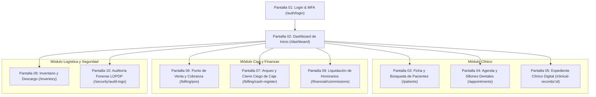

# ESPECIFICACIÓN DETALLADA DE PANTALLAS, WIREFRAMES Y FLUJOS UI/UX
## Proyecto: Sistema Integral de Gestión Odontológica y Expediente Clínico Digital (SIGO-Dental)

**Documentos de Referencia:** [`SRS_SIGO_Dental.md`](../SRS_SIGO_Dental.md), [`ARQUITECTURA_TECNICA_SIGO_DENTAL.md`](../ARQUITECTURA_TECNICA_SIGO_DENTAL.md)  
**Iconografía Estándar:** Google Material Symbols (Outlined). **Prohibido el uso de emojis.**  
**Filosofía de Archivos:** Separación estricta por componente (`.tsx`, `.module.css`, `use[Componente].ts`, `.types.ts`, `.test.tsx`, `index.ts`).  

---

## 1. MAPA DE NAVEGACIÓN Y PANTALLAS PRINCIPALES



---

## 2. DETALLE DE PANTALLAS Y WIREFRAMES

### PANTALLA 01: Autenticación de Acceso y Verificación MFA (`/auth/login`, `/auth/mfa`)

#### A. Propósito y Roles de Acceso
Acceso unificado para todos los perfiles con validación de credenciales criptográficas, prevención de ataques de fuerza bruta (bloqueo tras 5 intentos fallidos por 15 minutos en Redis) y doble factor de autenticación obligatorio para roles con acceso clínico o financiero.

#### B. Diagrama de Estructura Visual (Wireframe)
```
+---------------------------------------------------------------------------------+
|                                                                                 |
|                        [ LOGO SIGO-DENTAL (SVG) ]                               |
|              Sistema Integral de Gestión Odontológica Digital                   |
|                                                                                 |
|             +----------------------------------------------------+              |
|             | INICIO DE SESIÓN SEGURO                            |              |
|             | Acceso exclusivo a personal autorizado            |              |
|             |                                                    |              |
|             | Correo Electrónico o Usuario:                      |              |
|             | [ person ] [ doctor.mendez@sigodental.com        ] |              |
|             |                                                    |              |
|             | Contraseña:                                        |              |
|             | [ lock   ] [ •••••••••••••••••••••••••• ] [ eye  ] |              |
|             |                                                    |              |
|             | Sede Clínica de Ingreso:                           |              |
|             | [ domain ] [ Sede Central - Av. Médica 450      v] |              |
|             |                                                    |              |
|             | [ ] Recordar dispositivo seguro (30 días)          |              |
|             |                                                    |              |
|             | [              INGRESAR AL SISTEMA               ] |              |
|             |                                                    |              |
|             | ¿Olvidó su contraseña? Contacte al Administrador TI|              |
|             |                                                    |              |
|             | [verified_user] Conexión protegida con TLS 1.3     |              |
|             | Cumplimiento LOPDP / Normativa Sanitaria           |              |
|             +----------------------------------------------------+              |
|                                                                                 |
+---------------------------------------------------------------------------------+
```

#### C. Componentes de UI y Archivos Asociados
* `src/features/auth/components/login-card/LoginCard.tsx`
* `src/features/auth/components/login-card/LoginCard.module.css`
* `src/features/auth/components/login-card/useLoginCard.ts` (manejo de estado, reintentos y redirección MFA)
* `src/features/auth/components/mfa-modal/MfaModal.tsx` (código TOTP de 6 dígitos con teclado numérico)

---

### PANTALLA 02: Dashboard Principal / Inicio Multirrol (`/dashboard`)

#### A. Propósito y Comportamiento Adaptativo
Panel de control dinámico que renderiza widgets especializados según el rol del usuario conectado:
1. **Vista Odontólogo:** Mis citas del día, pacientes actualmente en sala de espera, accesos directos a odontograma y alertas médicas.
2. **Vista Recepción / Cajero:** Ocupación de sillones en vivo, citas por confirmar, accesos a cobros rápidos y alerta de estado de caja.
3. **Vista Director Médico / Administrador:** KPIs de ocupación de sillones, ingresos del día, tasa de ausentismo (No-Show) y alertas de insumos críticos.

#### B. Diagrama de Estructura Visual (Wireframe - Vista Odontólogo)
```
+-------------------------------------------------------------------------------------------------------+
| [menu] SIGO-DENTAL  | Sede Central v | [wifi] En Línea | [notifications (3)] | Dr. R. Méndez [account] |
+-------------------------------------------------------------------------------------------------------+
| [dentistry] Clínica | PANEL DE CONTROL MÉDICO - Dr. Roberto Méndez (Cirujano Dentista)               |
| [calendar] Agenda   | Fecha: Jueves, 30 de Octubre de 2026 | Sillón Asignado: Gabinete Quirúrgico 01 |
| [person] Pacientes  +-------------------------------------------------------------------------------+
| [vital] Periodonto  | METRICAS DE MI JORNADA                                                        |
|                     | [schedule] 8 Citas Agendadas | [person_check] 3 Atendidas | [hourglass] 1 En Sala|
| [receipt] POS       +-------------------------------------------------------------------------------+
| [inventory] Stock   | PACIENTE ACTUALMENTE EN SALA DE ESPERA                                        |
| [security] Auditoria| +---------------------------------------------------------------------------+ |
|                     | | Paciente: Juan Pérez Gómez (42 años) - DNI: 0928384912                     | |
|                     | | [warning] ALERTA: Alérgico a Penicilina | Cardiopatía controlada           | |
|                     | | Procedimiento: Exodoncia Tercer Molar #38 | Sillón: Gabinete 01           | |
|                     | | Tiempo en espera: 12 min | [ LLAMAR A CONSULTORIO ] [ ABRIR EXPEDIENTE ]  | |
|                     | +---------------------------------------------------------------------------+ |
|                     | CRONOGRAMA DE ATENCIÓN DE HOY                                                 |
|                     | +-------+------------------------+----------------------+--------------------+|
|                     | | Hora  | Paciente               | Tratamiento          | Estado             ||
|                     | +-------+------------------------+----------------------+--------------------+|
|                     | | 09:00 | Carlos Dávila Ruiz     | Resina Oclusal #16   | [check] Atendido   ||
|                     | | 10:30 | Ana Morales Vinueza    | Endodoncia Sesión 2  | [check] Atendido   ||
|                     | | 11:45 | Juan Pérez Gómez       | Cirugía Tercer Molar | [hourglass] En Sala||
|                     | | 15:00 | Laura Castillo Mena    | Evaluación Inicial   | [schedule] Pendient||
|                     | +-------+------------------------+----------------------+--------------------+|
+-------------------------------------------------------------------------------------------------------+
```

---

### PANTALLA 03: Gestión y Ficha Maestra de Pacientes (`/patients`)

#### A. Propósito
Centralizar la búsqueda en tiempo real, registro unificado de nuevos pacientes, validación de representantes legales para menores de edad y registro de antecedentes médicos con semáforo de riesgo vital (LOPDP).

#### B. Diagrama de Estructura Visual (Wireframe)
```
+-------------------------------------------------------------------------------------------------------+
| PACIENTES > Ficha Única del Paciente                                                                   |
| +----------------------------------------------------------------+ +--------------------------------+ |
| | [search] Buscar por DNI, Nombres, Teléfono o Código de Paciente| | [add] Registrar Nuevo Paciente | |
| +----------------------------------------------------------------+ +--------------------------------+ |
|                                                                                                       |
| PACIENTE SELECCIONADO: MARÍA ELENA SALAZAR ROJAS (ID: PAC-2026-0891)                                  |
| [warning] ALERTA MÉDICA CRÍTICA: TRATAMIENTO CON ANTICOAGULANTES (WARFARINA) - ALERGIA A AINES         |
+-------------------------------------------------------------------------------------------------------+
| [person] Datos Personales | [history_edu] Anamnesis LOPDP | [folder] Expediente | [payments] Cuenta   |
+-------------------------------------------------------------------------------------------------------+
| Cédula / DNI: 1718293847          | Fecha Nacimiento: 14/05/1984 (42 años) | Sexo: Femenino           |
| Teléfono Móvil: +593 99 876 5432  | Correo: m.salazar@email.com            | Estado Civil: Casada     |
| Dirección: Av. Amazonas N24-10    | Ocupación: Docente                     | Sede Frecuente: Central  |
|                                                                                                       |
| CONTACTO DE EMERGENCIA            | SEGURO / CONVENIO                                                 |
| Nombre: Jorge Morales (Esposo)   | Aseguradora: Dental Blue Shield Corp.                             |
| Teléfono: +593 98 123 4567        | Póliza: DNT-998231-A | Cobertura Odontológica: 80%                |
|                                                                                                       |
| ANTECEDENTES SISTÉMICOS (CIFRADO AES-256-GCM)                                                         |
| • Cardiovasculares: Hipertensión Arterial controlada (Losartán 50mg/día).                             |
| • Hemorrágicos: Paciente anticoagulada con Warfarina. Requiere INR previo a cirugía.                 |
|                                                                                                       |
| [ history ] Ver Bitácora de Auditoría de Accesos a este Expediente (LOPDP)                            |
+-------------------------------------------------------------------------------------------------------+
```

---

### PANTALLA 04: Agenda Médica y Control Físico de Sillones (`/appointments`)

#### A. Propósito y Reglas Clave
Gestión de turnos multirrecinto en vista de matriz por sillón dental. El sistema impide mediante bloqueo en backend la reserva simultánea en un mismo sillón físico (**RN-03**).

#### B. Diagrama de Estructura Visual (Wireframe)
```
+-------------------------------------------------------------------------------------------------------+
| AGENDA CLÍNICA | Fecha: [ 30 / Oct / 2026 ] [ Hoy ] | Vista: [ Sillones v ] | Filtro Sede: [ Central ]|
| +---------------------------------------------------------------------------------------------------+ |
| | LEYENDA ESTADOS: [Azul] Programado | [Verde] Confirmado | [Amarillo] En Sala | [Gris] Atendido    | |
| +---------------------------------------------------------------------------------------------------+ |
| HORA  | SILLÓN 01 (General)          | SILLÓN 02 (Cirugía)          | SILLÓN 03 (Ortodoncia)          |
|-------+------------------------------+------------------------------+---------------------------------|
| 08:00 | Dra. Carla Ortiz             | Dr. Roberto Méndez           | Dr. Miguel Paredes              |
|       | [Azul] Limpieza Profiláctica | [Verde] Exodoncia Compleja   | [Azul] Control Bracket Mes 4    |
|       | Pac: Fernando Ruiz           | Pac: Juan Pérez Gómez        | Pac: Sofía Alarcón              |
|-------+------------------------------+------------------------------+---------------------------------|
| 09:30 | [ LIBRE - AGENDAR AQUÍ ]     | Dr. Roberto Méndez           | Dr. Miguel Paredes              |
|       |                              | [Verde] Cirugía Apical #21   | [Amarillo] Cambio de Arco NiTi  |
|       |                              | Pac: Esteban Castro          | Pac: Gabriel Torres             |
|-------+------------------------------+------------------------------+---------------------------------|
| 11:00 | Dra. Carla Ortiz             | [ RESTRINGIDO: SANITIZACIÓN  | [ LIBRE - AGENDAR AQUÍ ]        |
|       | [Azul] Resina Compuesta #46  |   DE SILLÓN (15 MINUTOS) ]   |                                 |
|-------+------------------------------+------------------------------+---------------------------------|
| 12:00 | [ BLOQUEO ALMUERZO CLÍNICA ] | [ BLOQUEO ALMUERZO CLÍNICA ] | [ BLOQUEO ALMUERZO CLÍNICA ]    |
+-------------------------------------------------------------------------------------------------------+
```

---

### PANTALLA 05: Expediente Clínico, Odontograma 2D y Periodontograma (`/clinical-records/:id`)

#### A. Propósito
Núcleo del trabajo odontológico en consultorio. Pantalla ergonómica optimizada para tablets táctiles y PCs de sillón dental, dividida en pestañas clínicas unificadas.

#### B. Diagrama de Estructura Visual (Wireframe - Pestaña Odontograma)
```
+-------------------------------------------------------------------------------------------------------+
| PACIENTE: Juan Pérez Gómez (42a) | DNI: 0928384912 | [warning] ALERTA: ALÉRGICO A PENICILINA          |
+-------------------------------------------------------------------------------------------------------+
| [dentistry] ODONTOGRAMA | [vital_signs] PERIODONTO | [edit_note] NOTAS SOEP | [draw] CONSENTIMIENTOS   |
+-------------------------------------------------------------------------------------------------------+
| HERRAMIENTAS ACTIVAS:                                                                                 |
| [ Rojo ] Caries   [ Azul ] Obturación   [ Naranja ] Extracción   [ Verde ] Endodoncia   [ Limpiar ]   |
| Nomenclatura: (*) FDI (Internacional)   ( ) Universal (Americana)     Dentición: (*) Adulto  ( ) Niño |
|-------------------------------------------------------------------------------------------------------|
| MAXILAR SUPERIOR (Piezas 18 a 28)                                                                     |
|    18     17     16     15     14     13     12     11  |  21     22     23     24     25   26  27 28 |
|   [ X ]  [ O ]  [===]  [ O ]  [ O ]  [ O ]  [ O ]  [ O ] | [ O ]  [ O ]  [ O ]  [ O ]  [===][ O ][ O ]   |
|  Ausente Caries Resina                                                                                |
|                                                                                                       |
| MAXILAR INFERIOR (Piezas 48 a 38)                                                                     |
|    48     47     46     45     44     43     42     41  |  31     32     33     34     35   36  37 38 |
|   [ O ]  [ O ]  [===]  [ O ]  [ O ]  [ O ]  [ O ]  [ O ] | [ O ]  [ O ]  [ O ]  [ O ]  [ O ][===][ O ][!] |
|                                                                                           Cirugía Req |
|-------------------------------------------------------------------------------------------------------|
| DETALLE DEL HALLAZGO SELECCIONADO: Pieza 16 - Superficie Oclusal                                      |
| Diagnóstico: Caries dental limitada al esmalte (CIE-10: K02.0)                                        |
| Tratamiento Proyectado: Restauración con resina compuesta fotocurable de 1 superficie                 |
| Insumos a descargar: 1 kit aislamiento + 1 cartucho mepivacaína + 0.3g resina Filtek Supreme          |
| [ AGREGAR A PLAN DE TRATAMIENTO ]                                   [ GUARDAR EVOLUCIÓN ODONTOGRAMA ] |
+-------------------------------------------------------------------------------------------------------+
```

#### C. Sub-Pestaña: Evolución Médica SOEP
* **S (Subjetivo):** "Paciente refiere dolor punzante en cuadrante inferior izquierdo al masticar".
* **O (Objetivo):** "Caries profunda en pieza 38 con compromiso pulpar. Vitalidad térmica positiva dolorosa".
* **E (Evaluación):** "Pulpitis irreversible sintomática (CIE-10: K04.0)".
* **P (Plan):** "Exodoncia quirúrgica de tercer molar indicada. Se solicita consent. firmado y receta antibiótica".
* **Control de Inmutabilidad:** Contador de tiempo visible `Ventana de edición: Restan 18 horas, 42 min`. Al expirar, los campos se bloquean permanentemente y sólo se habilita el botón `[ + Nueva Nota de Adenda Aclaratoria ]`.

---

### PANTALLA 06: Punto de Venta (POS) y Cobranza Mixta (`/billing/pos`)

#### A. Propósito
Procesamiento de pagos con soporte para pagos combinados en múltiples monedas y pasarelas, generación de comprobantes electrónicos fiscales y actualización en tiempo real de cuentas corrientes.

#### B. Diagrama de Estructura Visual (Wireframe)
```
+-------------------------------------------------------------------------------------------------------+
| CAJA Y FACTURACIÓN > Punto de Venta (POS)                           | Turno: Turno Mañana (Caja 01)  |
+---------------------------------------------------------------------+---------------------------------+
| DETALLE DE LA ATENCIÓN A COBRAR                                     | LIQUIDACIÓN DE PAGO             |
| Paciente: Juan Pérez Gómez (DNI: 0928384912)                        |                                 |
| Tratamiento: Exodoncia Quirúrgica Tercer Molar (#38)                 | Subtotal:              $ 80.36  |
| Profesional: Dr. Roberto Méndez                                      | Descuento Autorizado: - $ 0.00  |
|                                                                     | I.V.A. (12% / 15%):    $ 09.64  |
| +-----------------------------------------------+---------+---------+ TOTAL A PAGAR:        $ 90.00  |
| | Ítem / Procedimiento                          | Cantidad| Total   |                                 |
| +-----------------------------------------------+---------+---------+---------------------------------+
| | Exodoncia Quirúrgica Pieza 38                 |    1    | $ 80.00 | FORMAS DE PAGO MIXTAS:          |
| | Fármaco Post-Operatorio (Ketorolaco 10mg)     |    1    | $ 10.00 | [ payments ] Efectivo:          |
| +-----------------------------------------------+---------+---------+ [ $ 40.00                     ] |
|                                                                     | [ credit_card ] Tarjeta Crédito:|
| TIPO DE COMPROBANTE FISCAL:                                         | [ $ 50.00                     ] |
| (*) Factura Electrónica    ( ) Boleta de Venta / Consumidor Final   | Lote Voucher: [ 004921        ] |
| Razón Social: Juan Pérez Gómez | RUC/DNI: 0928384912                |                                 |
| Correo Envío XML: juan.perez@email.com                              | Saldo Restante:        $  0.00  |
|                                                                     |                                 |
| [ receipt ] EMITIR FACTURA Y DESCARGAR STOCK                        | [ print ] Imprimir Recibo       |
+---------------------------------------------------------------------+---------------------------------+
```

---

### PANTALLA 07: Arqueo y Cierre Ciego de Caja Registradora (`/billing/cash-register`)

#### A. Propósito y Cumplimiento de Regla RN-02
El personal de caja **no puede consultar** el saldo teórico esperado por el sistema antes de digitar el conteo físico de dinero.

#### B. Diagrama de Estructura Visual (Wireframe)
```
+-------------------------------------------------------------------------------------------------------+
| ARQUEO DE CAJA > Protocolo de Cierre de Turno (Caja Ciega)          | Cajero: Andrea Solís (Turno AM) |
+-------------------------------------------------------------------------------------------------------+
| INSTRUCCIÓN OBLIGATORIA: Ingrese el recuento físico exacto de los valores custodiados en su gaveta.   |
| Los montos teóricos calculados por el sistema se revelarán únicamente tras enviar este arqueo formal. |
+-------------------------------------------------------------------------------------------------------+
| DESGLOSE DE EFECTIVO FÍSICO                                                                           |
| Billetes de $100: [  2 ] = $ 200.00      Monedas de $1.00:  [ 25 ] = $  25.00                         |
| Billetes de $50:  [  4 ] = $ 200.00      Monedas de $0.50:  [ 10 ] = $   5.00                         |
| Billetes de $20:  [  5 ] = $ 100.00      Monedas de $0.25:  [ 16 ] = $   4.00                         |
| Billetes de $10:  [  3 ] = $  30.00      Monedas de $0.10:  [ 10 ] = $   1.00                         |
| Billetes de $5:   [  4 ] = $  20.00                                                                   |
| TOTAL EFECTIVO DECLARADO POR EL CAJERO:                            $ 585.00                           |
|-------------------------------------------------------------------------------------------------------|
| COMPROBANTES DE TARJETAS Y TRANSFERENCIAS BANCARIAS                                                   |
| Total Vouchers de Tarjeta Declarados:                               $ 420.00                           |
| Total Comprobantes Transferencias Declarados:                       $ 150.00                           |
| TOTAL GENERAL DECLARADO:                                            $ 1,155.00                        |
|                                                                                                       |
| Observaciones / Justificación de Novedades:                                                           |
| [ Tuve una rotura de billete de $10 cambiada a cliente en la mañana...                              ] |
|                                                                                                       |
| [ lock ] ENVIAR ARQUEO Y PROCEDER AL CIERRE DEFINITIVO                                                |
+-------------------------------------------------------------------------------------------------------+
```

---

### PANTALLA 08: Auditoría Forense y Trazabilidad LOPDP (`/security/audit-logs`)

#### A. Propósito
Monitoreo inmutable para el CISO, Administrador de TI y Oficial de Protección de Datos Personales, con filtros por paciente, profesional, rango horario y tipo de acción sobre historias clínicas.

#### B. Diagrama de Estructura Visual (Wireframe)
```
+-------------------------------------------------------------------------------------------------------+
| AUDITORÍA FORENSE > Registro Inmutable de Accesos a Datos Clínicos (LOPDP Art. 40)                    |
+-------------------------------------------------------------------------------------------------------+
| FILTROS: [ Paciente: PAC-2026-0891 v ] [ Acción: Todos v ] [ Desde: 01/10/2026 ] [ Hasta: 30/10/2026 ]|
+-------------------------------------------------------------------------------------------------------+
| TIMESTAMP (UTC)      | USUARIO / ROL          | ACCIÓN | RECURSO AFECTADO      | IP ORIGEN    | MOTIVO|
|----------------------+------------------------+--------+-----------------------+--------------+-------|
| 2026-10-30T10:14:22Z | Dr. Roberto Méndez     | READ   | Antecedentes Médicos  | 192.168.1.45 | Cita  |
| 2026-10-30T10:28:01Z | Dr. Roberto Méndez     | WRITE  | Odontograma Pieza 38  | 192.168.1.45 | Aten. |
| 2026-10-30T10:45:10Z | Andrea Solís (Caja)    | READ   | Factura #001-02941    | 192.168.1.12 | Cobro |
| 2026-10-30T11:00:15Z | Dr. Carlos V. (Admin)  | EXPORT | Historial Clínico PDF | 192.168.1.05 | Requer|
+-------------------------------------------------------------------------------------------------------+
| [verified] Cadena de Integridad SHA-256 Verificada: Sin alteraciones detectadas en base de datos.    |
| [ download ] Exportar Reporte Forense Certificado con Firma Electrónica                               |
+-------------------------------------------------------------------------------------------------------+
```
