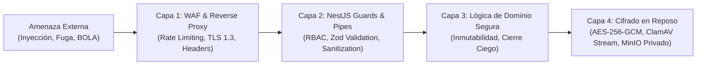

# ESTÁNDARES DE CIBERSEGURIDAD OWASP TOP 10 Y ASVS NIVEL 2
## Proyecto: Sistema Integral de Gestión Odontológica y Expediente Clínico Digital (SIGO-Dental)

**Documentos de Referencia:** [`SRS_SIGO_Dental.md`](../SRS_SIGO_Dental.md), [`ARQUITECTURA_TECNICA_SIGO_DENTAL.md`](../ARQUITECTURA_TECNICA_SIGO_DENTAL.md), [`GEMINI.md`](../GEMINI.md)  
**Marco Normativo:** OWASP Top 10:2021, OWASP API Security Top 10:2023, OWASP ASVS 4.0 (Nivel 2 - Salud / Aplicaciones Clínicas) y LOPDP.  
**Estado:** Mandatorio e Inviolable  

---

## 1. MATRIZ DE DEFENSA EN PROFUNDIDAD CONTRA OWASP TOP 10 (WEB)

| ID Riesgo OWASP | Nombre del Riesgo | Amenaza en el Contexto Odontológico | Mecanismo de Defensa Implementado en SIGO-Dental |
| :--- | :--- | :--- | :--- |
| **A01:2021** | **Broken Access Control** (Control de Acceso Roto) | Un odontólogo intenta consultar expedientes o liquidaciones de otros profesionales modificando el ID en la URL. | • Todos los identificadores son **UUID v4** no predecibles. • Guards `@Roles()` y `@BranchScope()` en NestJS que validan la pertenencia del recurso al profesional o sede activa en sesión. • Impedir visualización de saldos teóricos al rol cajero (Arqueo ciego). |
| **A02:2021** | **Cryptographic Failures** (Fallas Criptográficas) | Volcado no autorizado de la base de datos PostgreSQL expone diagnósticos de VIH, hepatitis o antecedentes de pacientes. | • **Cifrado a Nivel de Campo (Field-Level Encryption) con AES-256-GCM** en campos patológicos sensibles. • Cifrado en tránsito obligatorio con **TLS 1.3**. • Contraseñas protegidas mediante hash **Argon2id** con salting dinámico. • Almacenamiento S3 100% privado con URLs prefirmadas de 5 min. |
| **A03:2021** | **Injection** (Inyecciones SQL / NoSQL / Command) | Inyección SQL a través de campos de búsqueda rápida de pacientes o inyección de comandos en nombres de archivos. | • Uso exclusivo de **Prisma ORM** con consultas tipadas y parametrizadas al 100% (cero SQL crudo concatenado). • Sanitización de nombres de archivos a `{sha256}_{uuid}.ext`. • Escaneo antivirus vía socket TCP `INSTREAM` en ClamAV sin invocar binarios del sistema operativo vía shell. |
| **A04:2021** | **Insecure Design** (Diseño Inseguro) | Fraude por alteración retroactiva de notas médicas para encubrir mala praxis o doble cobro de citas. | • Regla inviolable de **Inmutabilidad SOEP (24 horas)** con soporte exclusivo de *Notas de Adenda*. • Restricción física en base de datos (`EXCLUDE USING gist`) para colisiones de sillones. • Bloqueo de procedimientos quirúrgicos sin consentimiento informado firmado. |
| **A05:2021** | **Security Misconfiguration** (Mala Configuración) | Servidores web exponiendo trazas de error con información de la infraestructura o cabeceras HTTP inseguras. | • Middleware **Helmet** configurado estrictamente: `Content-Security-Policy`, `HSTS`, `X-Content-Type-Options: nosniff`, `X-Frame-Options: DENY`. • Deshabilitación total de Swagger (`/api/docs`) en entornos productivos fuera de VPN. • Contenedores Docker ejecutados con usuarios sin privilegios (`USER node`). |
| **A06:2021** | **Vulnerable and Outdated Components** | Librerías de npm o imágenes base de Docker con CVEs conocidos explotables. | • Escaneo automatizado en pipeline CI/CD con **Trivy** (imágenes Docker) y **Snyk / npm audit** (dependencias). • Bloqueo de compilación si existen vulnerabilidades de severidad Alta o Crítica. |
| **A07:2021** | **Identification and Authentication Failures** | Ataques de fuerza bruta contra el login médico o secuestro de tokens de sesión. | • **Rate Limiting con Redis:** Máximo 5 intentos fallidos consecutivos de login por IP/cuenta antes de bloqueo temporal de 15 minutos. • **MFA obligatorio** vía TOTP. • Access Token JWT con vida útil reducida de **15 minutos**. • Refresh Token en cookie segura `HttpOnly`, `SameSite=Strict`, `Secure`. • Revocación instantánea en Redis mediante lista negra de tokens (`blacklist:token:{jti}`). |
| **A08:2021** | **Software and Data Integrity Failures** | Subida de radiografías falsificadas o documentos con macros maliciosas para comprometer tablets de sillón. | • Análisis de **Magic Bytes** con librería `file-type` para verificar el tipo MIME real. • **Escaneo en memoria en streaming con ClamAV** antes de almacenar en MinIO/S3. • Hash de integridad SHA-256 incrustado en cada documento PDF/A firmado digitalmente. |
| **A09:2021** | **Security Logging and Monitoring Failures** | Un usuario descarga historiales clínicos masivos y el sistema no deja registro auditable. | • Bitácora inmutable en tabla `audit_logs` (*append-only*): toda lectura, descarga o modificación de datos sensibles registra Actor, IP, Timestamp, Recurso y Motivo. • Alertas automáticas en tiempo real ante más de 10 lecturas de expedientes por minuto por un mismo usuario. |
| **A10:2021** | **Server-Side Request Forgery (SSRF)** | Envío de peticiones falsificadas hacia la red interna a través del motor de webhooks de notificaciones. | • Whitelist rígida de dominios permitidos para Webhooks salientes (exclusivamente Meta Cloud API, Twilio y Pasarela Fiscal). • Bloqueo estricto de peticiones hacia rangos privados (RFC 1918: `10.0.0.0/8`, `172.16.0.0/12`, `192.168.0.0/16`, `127.0.0.1/8`). |

---

## 2. OWASP API SECURITY TOP 10 (2023) EN ENDPOINTS NESTJS

1. **API1:2023 - Broken Object Level Authorization (BOLA):**
   * *Mitigación:* Cada controlador inyecta el `CurrentUser()` extraído del JWT. Las consultas a `/api/v1/clinical-records/:id` o `/api/v1/appointments/:id` validan en base de datos que el recurso pertenezca a la sede del solicitante o que el profesional tenga asignado al paciente.
2. **API2:2023 - Broken Authentication:**
   * *Mitigación:* Se prohíbe el uso de tokens en parámetros de consulta URL (`?token=...`). Se exige cabecera `Authorization: Bearer <JWT>` y cookies firmadas para refresco.
3. **API3:2023 - Broken Object Property Level Authorization (BOPLA):**
   * *Mitigación:* DTOs con `class-validator` y `whitelist: true` + `forbidNonWhitelisted: true`. El cliente no puede inyectar propiedades administrativas (ej. `isAdmin: true` o `commissionRate: 50`) en peticiones de actualización de perfil.
4. **API4:2023 - Unrestricted Resource Consumption:**
   * *Mitigación:* Rate Limiter global por IP y por usuario mediante `@nestjs/throttler` sobre Redis. Máximo 100 peticiones/minuto por usuario para navegación estándar y 10 peticiones/minuto para endpoints pesados de exportación de PDF.
5. **API5:2023 - Broken Function Level Authorization (BFLA):**
   * *Mitigación:* Endpoints de cierre de caja, auditoría o configuración protegidos mediante decorador `@Roles(Role.ADMIN_TI, Role.CONTADOR)` validado en el guard de ejecución antes de alcanzar el servicio.

---

## 3. CHECKLIST DE CUMPLIMIENTO OWASP ASVS 4.0 (NIVEL 2 - SALUD)

El estándar **OWASP Application Security Verification Standard (ASVS) Nivel 2** es el marco de referencia formal para aplicaciones que gestionan transacciones financieras o datos confidenciales de salud:

### V1: Arquitectura, Diseño y Modelado de Amenazas
- [ ] V1.1.1: Existe un modelo de amenazas documentado para la protección de historiales médicos.
- [ ] V1.2.1: Todos los componentes del sistema están aislados por capas (Frontend, WAF, API, Storage, DB).
- [ ] V1.5.1: Se respeta el principio de menor privilegio en los roles de base de datos (`sigo_user` no es superusuario de PostgreSQL).

### V2: Autenticación y Gestión de Credenciales
- [ ] V2.1.1: Las contraseñas exigen un mínimo de 12 caracteres, alfanumérico y símbolos.
- [ ] V2.1.7: Se verifica que la contraseña ingresada no figure en listas de contraseñas comprometidas (*HaveIBeenPwned*).
- [ ] V2.2.1: El tiempo de caducidad por inactividad de sesión está fijado en 15 minutos continuos.
- [ ] V2.8.1: Doble factor de autenticación (TOTP RFC 6238) operativo para roles con acceso clínico y contable.

### V3: Gestión de Sesiones
- [ ] V3.2.1: Los tokens de sesión se generan mediante generadores criptográficamente seguros (CSPRNG).
- [ ] V3.3.1: Las cookies de sesión poseen las banderas `HttpOnly`, `Secure`, `SameSite=Strict`.
- [ ] V3.4.1: Al cerrar sesión, el token queda inmediatamente revocado en el blacklist de Redis.

### V4: Control de Acceso
- [ ] V4.1.1: El control de acceso se valida exclusivamente en el servidor (backend), nunca solo en la UI.
- [ ] V4.2.1: Se impide el acceso directo a objetos mediante identificadores secuenciales (uso de UUID v4).

### V5: Validación de Entradas y Sanitización
- [ ] V5.1.1: Toda entrada es validada contra un esquema estricto (Zod / class-validator) en el backend.
- [ ] V5.3.1: Toda salida HTML es codificada automáticamente por React DOM para prevenir Cross-Site Scripting (XSS).
- [ ] V5.5.1: Los archivos subidos se verifican por cabecera binaria (*Magic Bytes*) y se escanean con ClamAV.

### V8: Criptografía en Reposo y Tránsito
- [ ] V8.1.1: Se utilizan únicamente algoritmos modernos probados (AES-256-GCM, TLS 1.3, Argon2id).
- [ ] V8.2.1: Las claves criptográficas maestras se inyectan como variables de entorno aisladas y nunca se versionan en Git.
- [ ] V8.3.1: Los datos médicos críticos se almacenan con Cifrado a Nivel de Campo (*Field-Level Encryption*).

### V10: Almacenamiento Seguro de Archivos
- [ ] V10.1.1: Los archivos se guardan fuera de la raíz web en buckets S3 privados sin permisos públicos.
- [ ] V10.2.1: Los enlaces de descarga son temporales mediante URLs prefirmadas (máximo 300 segundos).

### V11: Comunicaciones Seguras
- [ ] V11.1.1: Todo el tráfico HTTP es redirigido obligatoriamente a HTTPS mediante regla HSTS (`max-age=31536000`).
- [ ] V11.1.2: Se deshabilitan protocolos antiguos e inseguros (SSL v2/v3, TLS 1.0, TLS 1.1).
