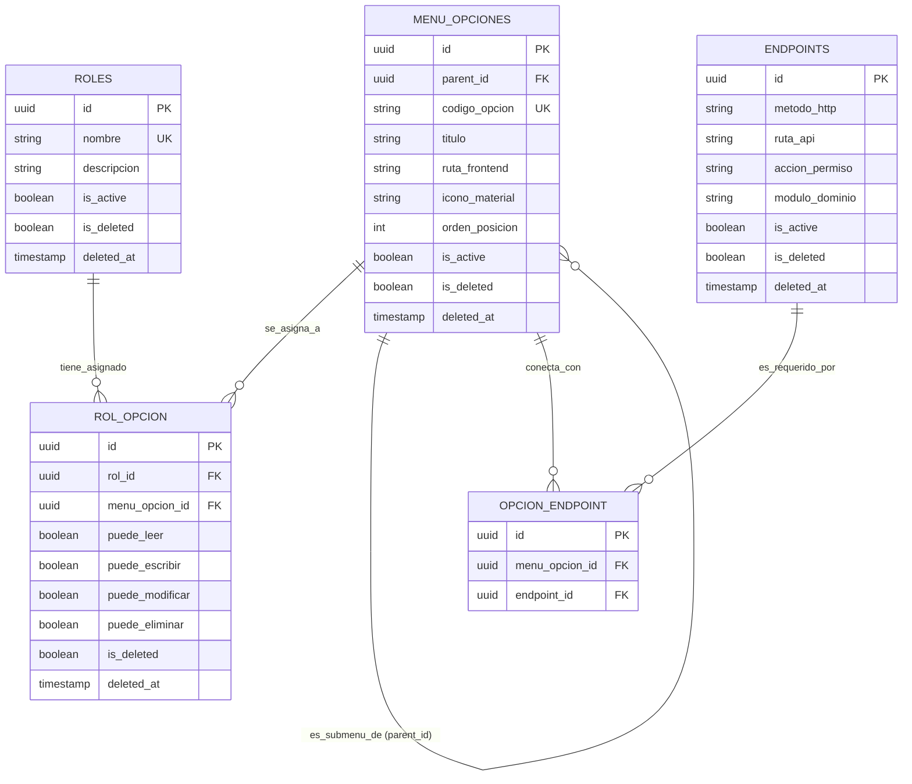

# MODELO DE DATOS DINÁMICO, RBAC, SOFT DELETE CON ÍNDICES PARCIALES Y GESTIÓN DE ERRORES (30X, 40X, 50X)
## Proyecto: Sistema Integral de Gestión Odontológica y Expediente Clínico Digital (SIGO-Dental)

**Documentos de Referencia:** [`SRS_SIGO_Dental.md`](../SRS_SIGO_Dental.md), [`ARQUITECTURA_TECNICA_SIGO_DENTAL.md`](../ARQUITECTURA_TECNICA_SIGO_DENTAL.md), [`GEMINI.md`](../GEMINI.md)  
**Estado:** Mandatorio e Inviolable  

---

## 1. IDENTIFICADORES UNIVERSALES UUID V4

Para mitigar riesgos de **Enumeración de Recursos e Insecure Direct Object References (IDOR / OWASP A01)**, se prohíbe el uso de identificadores enteros secuenciales (`SERIAL`, `AUTO_INCREMENT`) en todas las entidades del sistema:

* Todas las llaves primarias (`PK`) y foráneas (`FK`) se definen estrictamente como **`UUID v4`** (`gen_random_uuid()` en PostgreSQL 16).
* Beneficios técnicos:
  1. Imposibilidad de predecir IDs de pacientes, turnos, comprobantes o expedientes clínicos mediante ataques de fuerza bruta.
  2. Generación segura y desacoplada de identificadores tanto en backend como en frontend antes de la persistencia física.
  3. Replicación multi-sede y multi-región nativa sin colisiones de identificadores numéricos.

---

## 2. SISTEMA DINÁMICO DE NAVEGACIÓN Y ACCESOS (SIN RUTAS HARDCODEADAS)

Se prohíbe explícitamente definir o condicionar los menús del Sidebar mediante listas estáticas hardcodeadas en el frontend. La navegación y la autorización de llamadas API se gestionan de forma dinámica y desacoplada mediante un modelo relacional de **5 tablas maestras**:



### 2.1 Flujo Operativo Dinámico (Frontend & Backend)

1. **Carga Dinámica del Menú en Frontend:**
   * Al autenticarse el usuario, el frontend solicita `GET /api/v1/auth/my-navigation`.
   * El backend consulta las opciones activas (`is_deleted = false`) asignadas a los roles del usuario mediante la tabla puente `rol_opcion`, devolviendo el árbol JSON ordenado por `orden_posicion`.
   * El componente `Sidebar.tsx` itera este árbol para renderizar las opciones, iconos de Google Material Symbols y rutas, sin depender de ninguna estructura estática en el código cliente.
2. **Validación de Acceso a Endpoints en Backend (Guard Dinámico):**
   * Cuando el usuario ejecuta una petición HTTP (ej. `POST /api/v1/clinical-records/123/soep`), el interceptor `DynamicRbacGuard`:
     1. Obtiene el rol del token JWT.
     2. Resuelve si el endpoint solicitado (`POST`, `/api/v1/clinical-records/:id/soep`) está vinculado en `opcion_endpoint` a una opción habilitada en `rol_opcion` con permiso `puede_escribir = true`.
     3. Si no existe la vinculación o el permiso está revocado, deniega la petición inmediatamente con `HTTP 403 Forbidden`.

---

## 3. MATRIZ EXHAUSTIVA DE ACCESOS POR ROL

| Módulo / Recurso | Admin TI | Director Médico | Odontólogo | Asistente Dental | Recepcionista | Cajero | Contador | Paciente (Portal) |
| :--- | :---: | :---: | :---: | :---: | :---: | :---: | :---: | :---: |
| **Gestión de Usuarios y Roles** | **CRUD** | Solo Lectura | Sin Acceso | Sin Acceso | Sin Acceso | Sin Acceso | Sin Acceso | Sin Acceso |
| **Parámetros de Sede y Sillones** | **CRUD** | **CRUD** | Lectura | Lectura | Lectura | Lectura | Lectura | Sin Acceso |
| **Ficha de Paciente (Demográfica)** | Lectura | **CRUD** | **CRUD** | **CRUD** | **CRUD** | **CRUD** | Sin Acceso | Solo Propia |
| **Anamnesis y Alertas Médicas (LOPDP)**| Sin Acceso | **CRUD** | **CRUD** | Solo Alertas | Solo Alertas | Sin Acceso | Sin Acceso | Lectura Propia |
| **Odontograma 2D y Periodontograma** | Sin Acceso | **CRUD** | **CRUD** | Solo Lectura | Sin Acceso | Sin Acceso | Sin Acceso | Visualización |
| **Notas SOEP e Inmutabilidad (24h)** | Sin Acceso | **CRUD** | **Crear/Adenda**| Sin Acceso | Sin Acceso | Sin Acceso | Sin Acceso | Sin Acceso |
| **Consentimiento Informado (Firma)** | Sin Acceso | Lectura/Anular| **Crear/Firmar**| Preparar | Enviar OTP | Sin Acceso | Sin Acceso | **Firma Propia** |
| **Recetas Médicas con QR** | Sin Acceso | **CRUD** | **Emitir** | Sin Acceso | Sin Acceso | Sin Acceso | Sin Acceso | Descarga PDF |
| **Agenda y Sillones Dentales** | Lectura | **CRUD** | Sus Citas | Su Sillón | **CRUD** | Lectura | Sin Acceso | Agendar Citas |
| **Punto de Venta (POS) y Cobranza** | Sin Acceso | Supervisión | Consulta | Sin Acceso | **Cobrar** | **Cobrar** | Consulta | Pagar en línea |
| **Arqueo y Cierre Ciego de Caja** | Sin Acceso | Supervisión | Sin Acceso | Sin Acceso | **Ejecutar Ciego**| **Ejecutar Ciego**| **Auditar/Aprobar**| Sin Acceso |
| **Inventario y Recetas Clínicas** | Auditoría | Supervisión | Consulta Receta| **Registrar Uso**| Sin Acceso | Sin Acceso | **Gestión Costos**| Sin Acceso |
| **Liquidación de Comisiones** | Sin Acceso | **Aprobar** | Ver Propias | Sin Acceso | Sin Acceso | Sin Acceso | **Calcular/Pagar** | Sin Acceso |
| **Bitácora de Auditoría Forense** | **Lectura WORM**| **Lectura WORM**| Sin Acceso | Sin Acceso | Sin Acceso | Sin Acceso | **Lectura WORM** | Sin Acceso |

---

## 4. GESTIÓN DE SOFT DELETE Y PARTIAL UNIQUE INDEXES

### 4.1 Principio de Borrado Lógico (Soft Delete)
Se prohíbe el borrado físico (`DELETE FROM`) de registros en entidades de negocio. Toda tabla debe implementar los campos:
* `is_deleted`: `BOOLEAN NOT NULL DEFAULT FALSE`
* `deleted_at`: `TIMESTAMP WITH TIME ZONE NULL DEFAULT NULL`

### 4.2 El Desafío del Soft Delete con Códigos Únicos
En una base de datos estándar, si una columna posee una restricción `UNIQUE` (ej. `codigo_procedimiento`, `email`, `documento_identidad`, `sku`), un registro eliminado lógicamente (`is_deleted = true`) impide dar de alta un nuevo registro con el mismo código, generando un falso conflicto de duplicidad.

### 4.3 Solución Arquitectónica: Partial Unique Indexes en PostgreSQL 16
Para permitir que un código, SKU o DNI previamente eliminado pueda volver a registrarse sin error, se reemplazan los constraints únicos estándar por **Índices Parciales Únicos condicionados a `WHERE is_deleted = false`**:

```sql
-- 1. Unicidad de Documento de Paciente (solo para registros activos)
CREATE UNIQUE INDEX uq_patients_document_active 
ON patients (document_number) 
WHERE is_deleted = false;

-- 2. Unicidad de Correo de Usuario del Sistema
CREATE UNIQUE INDEX uq_users_email_active 
ON users (email) 
WHERE is_deleted = false;

-- 3. Unicidad de Código de Procedimiento Odontológico
CREATE UNIQUE INDEX uq_procedures_code_active 
ON procedure_catalog (code) 
WHERE is_deleted = false;

-- 4. Unicidad de SKU de Insumos Clínicos
CREATE UNIQUE INDEX uq_inventory_sku_active 
ON inventory_items (sku) 
WHERE is_deleted = false;

-- 5. Unicidad de Nombre de Sillón Dental por Sede
CREATE UNIQUE INDEX uq_dental_chair_name_active 
ON dental_chairs (branch_id, name) 
WHERE is_deleted = false;

-- 6. Unicidad de Código de Opción de Menú
CREATE UNIQUE INDEX uq_menu_options_code_active 
ON menu_options (codigo_opcion) 
WHERE is_deleted = false;
```

#### Comportamiento Validado:
1. Se crea el insumo con SKU `RES-FILTEK-A2` (`is_deleted = false`).
2. Se borra lógicamente el insumo: `UPDATE inventory_items SET is_deleted = true, deleted_at = NOW() WHERE sku = 'RES-FILTEK-A2'`.
3. El índice parcial **ignora** la fila eliminada.
4. Se crea un nuevo insumo con SKU `RES-FILTEK-A2` (`is_deleted = false`): **PostgreSQL acepta la inserción limpiamente sin violar la unicidad**.

---

## 5. ARQUITECTURA ESTANDARIZADA DE GESTIÓN DE ERRORES (30X, 40X, 50X)

Todas las respuestas de error del sistema se unifican bajo la especificación internacional **RFC 7807 (Problem Details for HTTP APIs)**, garantizando que el frontend maneje estados y mensajes de forma predecible:

### 5.1 Estructura Estándar del Payload de Error (JSON)

```json
{
  "type": "https://api.sigodental.com/errors/CHAIR_ALREADY_OCCUPIED",
  "title": "Conflicto de Agendamiento",
  "status": 409,
  "detail": "El Sillón Dental 02 ya se encuentra reservado en el rango horario solicitado (10:00 - 11:00).",
  "instance": "/api/v1/appointments",
  "errorCode": "ERR_CHAIR_COLLISION",
  "timestamp": "2026-10-30T10:15:30Z",
  "traceId": "c91bacae-aa5f-407a-bbec-18b7611b315d",
  "invalidParams": []
}
```

---

### 5.2 Catálogo de Códigos y Comportamiento por Familia

#### Familia 30x: Redirecciones y Caché
* **`301 Moved Permanently`:** Utilizado en el reverse proxy Nginx para forzar la redirección permanente de tráfico HTTP a HTTPS (TLS 1.3).
* **`302 Found (Temporary Redirect)`:** Redirección temporal durante flujos de autenticación hacia la pantalla de verificación MFA (`/auth/mfa-verify`).
* **`304 Not Modified`:** Respuesta de alto rendimiento para recursos clínicos inmutables cacheados con `ETag` (radiografías históricas, fotos de pacientes, odontogramas archivados). El frontend consume el asset desde su caché local sin transferencia de bytes.

#### Familia 40x: Errores del Cliente
* **`400 Bad Request (ERR_VALIDATION_FAILED)`:** Fallo de validación de esquema en DTO (Zod / class-validator). Retorna el array `invalidParams` con el detalle de campos fallidos.
* **`401 Unauthorized (ERR_TOKEN_EXPIRED / ERR_INVALID_CREDENTIALS)`:** Token ausente, firma JWT inválida o expiración del tiempo de vida (15 min). Dispara el intento de refresco transparente con `Refresh Token`.
* **`403 Forbidden (ERR_INSUFFICIENT_PERMISSIONS / ERR_SOEP_EDIT_EXPIRED)`:** 
  * Acceso a recursos fuera del rol asignado.
  * Intento de editar una nota de evolución SOEP trascurrida la ventana de 24 horas (**RN-01**).
* **`404 Not Found (ERR_RESOURCE_NOT_FOUND)`:** Recurso inexistente o marcado como `is_deleted = true`.
* **`409 Conflict (ERR_CHAIR_COLLISION / ERR_CODE_ALREADY_EXISTS)`:**
  * Intento de solapamiento de turno en el mismo sillón dental físico (**RN-03**).
  * Intento de registrar un código único que ya está activo (`is_deleted = false`).
* **`422 Unprocessable Entity (ERR_MALWARE_DETECTED / ERR_MISSING_CONSENT)`:**
  * El escaneo de ClamAV detectó una firma de virus o malware en el archivo subido.
  * Intento de cerrar una cita médica quirúrgica sin el consentimiento informado firmado (**RN-05**).
* **`429 Too Many Requests (ERR_RATE_LIMIT_EXCEEDED)`:** Umbral de rate limiting superado (ej. más de 5 intentos de login fallidos o más de 100 req/min).

#### Familia 50x: Errores del Servidor
* **`500 Internal Server Error (ERR_INTERNAL_SERVER_ERROR)`:** Excepción no controlada en el backend. **Regla de Seguridad OWASP:** Se oculta totalmente la traza técnica de error al usuario y se genera un `traceId` único para que soporte técnico investigue en los logs de CloudWatch/ELK.
* **`502 Bad Gateway (ERR_EXTERNAL_GATEWAY_DOWN)`:** Caída o respuesta errónea de APIs externas (Web Service de facturación tributaria, Meta Cloud WhatsApp o Twilio).
* **`503 Service Unavailable (ERR_DATABASE_UNAVAILABLE)`:** Contenedor de PostgreSQL o Redis en proceso de recuperación o mantenimiento programado.
* **`504 Gateway Timeout (ERR_UPSTREAM_TIMEOUT)`:** Tiempo de espera excedido al procesar operaciones complejas (ej. timbrado de factura o generación de PDFs pesados).
